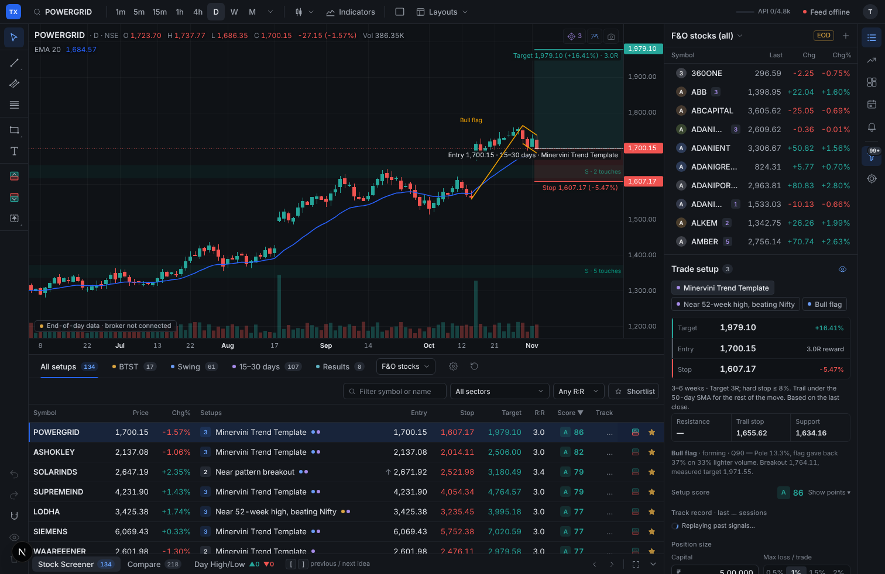
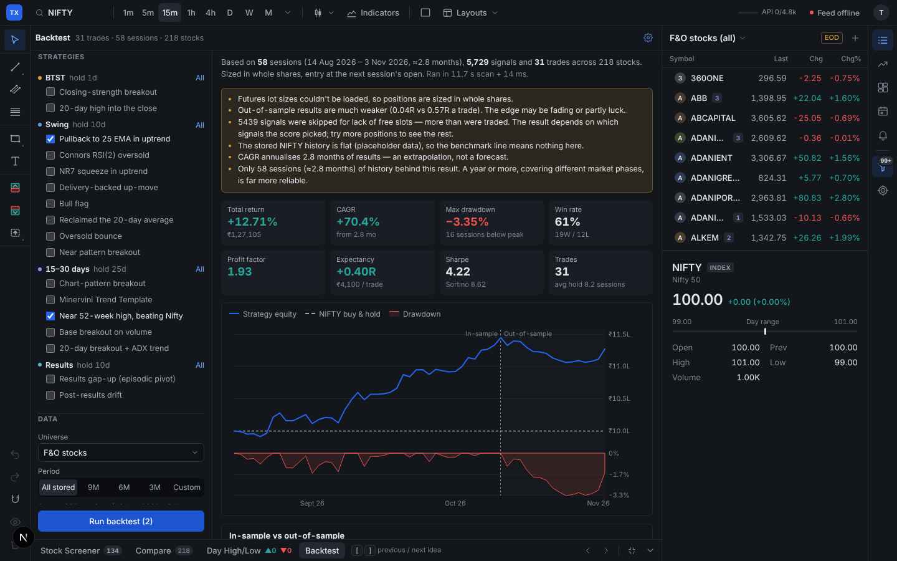
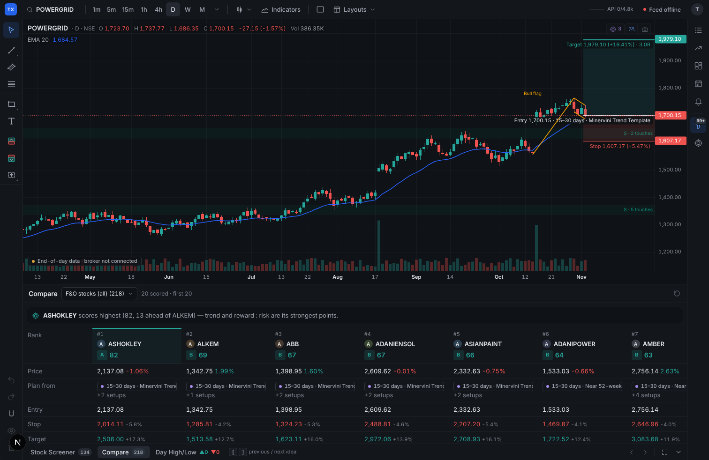

<div align="center">

# Tradex

**Shortlist stock-futures trades on NSE: charts, screeners, setup scores and backtests in one open-source terminal.**

[](https://github.com/ice-009/tradex-public/actions/workflows/ci.yml)
[](LICENSE)


[Features](#features) · [Getting started](#getting-started) · [Architecture](#architecture) · [Roadmap](#roadmap) · [Contributing](#contributing)

</div>

**An open-source trading terminal for Indian (NSE) stock futures, built to shortlist trades.** Tradex combines TradingView-style charts with screeners, a 100-point setup score, a portfolio backtester and live prices, so you can narrow 200+ F&O stocks down to the one or two worth taking. You place orders in your broker's app; Tradex never sends one.



> **Not investment advice.** Tradex is a research tool. Its screens, scores and backtests describe what rules did on past data; they don't predict what a stock will do. Check every idea yourself and trade at your own risk.

## Features

**Charts**
- A fast canvas chart engine: candles, hollow candles, Heikin-Ashi, OHLC bars, line and area.
- Indicators, including Smart Money Concepts, plus automatic chart patterns (triangles, rectangles, bull flags, double bottoms, VCP, cup-and-handle) with support/resistance zones.
- Drawing tools, and multi-chart layouts with linked symbols and crosshairs.
- Designed for iPad and 13–14" laptops; installable as a home-screen app.

**Shortlisting**
- 17 screens in four horizons: **BTST** (overnight), **Swing** (3–10 sessions), **15–30 days** and **Results** (post-earnings drift and gaps). Each cites its sources.
- Every match comes with a **trade plan** (entry, stop, target, exit rule) and a **100-point setup score** across eight factors: trend, relative strength, accumulation, pattern, reward:risk, stop distance, extension and track record. Penalties apply for results inside the holding period, gaps and falling days.
- **Track record** shows how often each screen's past signals hit target before stop. **Compare** ranks a whole watchlist side by side.
- Live watchlists (every F&O stock, grouped by sector), market movers, sector strength, an NSE results calendar and price alerts.
- A **Day High / Low** scanner for F&O cash and near-month futures.
- A futures **order ticket helper**: the right contract, basis-adjusted levels, lots sized from your max loss, and GTT OCO prices to copy into your broker.

**Backtesting**
- A portfolio backtest of any combination of screens. It uses risk-% sizing, position limits and full Indian futures costs: brokerage, STT, exchange and SEBI fees, stamp duty, GST and slippage.
- Results include an equity curve against NIFTY with drawdown, a monthly heatmap, a trade list and an **in-sample vs out-of-sample** split, with plain warnings when a result isn't robust.



**Data**
- A source-independent **data engine**: history, quotes and live prices come through one pipeline, with fallbacks (broker → NSE end-of-day files → labelled sample data).
- Live prices stream from the broker's socket when available and fall back to polling otherwise. A watchdog reconnects silent feeds.
- A **request budget** keeps every broker API call inside the plan's per-second, per-minute and per-day limits.



## Getting started

**Requirements:** Node.js 20.9 or newer, and npm.

```bash
git clone https://github.com/ice-009/tradex-public.git
cd tradex-public
npm install                 # also generates the Prisma client
cp .env.example .env        # then set NEXTAUTH_SECRET (openssl rand -base64 32)
npm run db:setup            # creates the local SQLite database
npm run dev
```

Open http://localhost:3000, create a local account (stored only in your `dev.db`) and sign in.

### Connecting a broker (Fyers)

Live data currently comes from [Fyers API v3](https://myapi.fyers.in/docs). Create an app in the Fyers API dashboard, then fill in the `FYERS_*` values in `.env` (see [`.env.example`](.env.example)):
- **App ID and secret** for your API app.
- **Fyers login ID and PIN.**
- **TOTP secret** from enabling external 2FA in your Fyers account. Tradex uses it to log in on the server each morning, when Fyers tokens expire.

Set `FYERS_PLAN=prime` if you're on Prime, so the request budget uses Prime's limits.

On first run with a broker, the screener downloads about a year of daily history for the F&O list. That's one API call per stock, paced inside the rate limits, so it takes roughly 10 minutes. After that, history is extended every evening from NSE's free bhavcopy files.

### Without a broker

The app runs, but with less:

| Works without a broker | Needs a broker |
|---|---|
| Charts (daily from stored history; intraday as clearly labelled sample data) | Live prices |
| Drawing tools, layouts, alerts UI | The screener's first history download |
| Backtests on history you already have | Intraday history, Day High/Low |

To support another broker, write a data-source adapter (see [Architecture](#architecture)).

## Architecture

Tradex is a Next.js 16 app (React 19, TypeScript). The server side runs in the same process: API routes, a disk cache and one broker connection. The code is split into layers, and ESLint enforces the boundaries, so a wrong import fails the build.

```
            ┌──────────────────────────── browser ────────────────────────────┐
            │  src/terminal   React UI + UI state (store, prefs, layouts)     │
            │       │                     │                                   │
            │       ▼                     ▼                                   │
            │  src/client     data feeds  src/chart   canvas chart renderer   │
            │  (api.ts = the only fetch)                                      │
            └───────┼─────────────────────────────────────────────────────────┘
                    │  HTTP + Server-Sent Events, shapes in src/contracts/api.ts
            ┌───────▼──────────────────────── server ─────────────────────────┐
            │  src/app/api     thin route handlers: parse → service → JSON    │
            │       ▼                                                         │
            │  src/server/services    one use case per file                   │
            │       ▼                                                         │
            │  src/server/data        data engine: sources, fallback, cache,  │
            │                         live market stream                      │
            │       ▼                                                         │
            │  src/server/providers   Fyers client/socket/budget, NSE files   │
            └───────┼─────────────────────────────────────────────────────────┘
                    ▼
            src/core   pure calculation engine — used by both sides
```

| Layer | Folder | What's in it |
|---|---|---|
| Engine | `src/core` | Indicators, patterns, screens, scoring, backtester, tick/futures maths, IST session rules, file parsers, rate-limit policy. Pure functions, no I/O. |
| Contracts | `src/contracts/api.ts` | The JSON shape of every API response, shared by both ends. |
| Data engine | `src/server/data` | `DataSource` adapters (Fyers, NSE end-of-day, sample), the `DataEngine` (ordered fallback, rests failing sources, incremental disk history, quote cache) and the `MarketStream` (one live price pipeline: socket or polling, with a watchdog). |
| Providers | `src/server/providers` | Raw clients: Fyers REST/socket/auth, the API request budget, the NSE bhavcopy daily store, lot sizes, results calendar, universes. |
| Services and routes | `src/server/services`, `src/app/api` | One use case per service; routes only parse, call and return. |
| Client data | `src/client` | Typed API fetchers and feeds (market data, screener, high/low, lots). |
| Renderer | `src/chart` | The canvas chart: drawing, annotations, theme. |
| UI | `src/terminal` | Panels, dialogs, layouts and UI state. |

**How data flows:**
1. A chart asks `/api/chart`. The chart service asks the data engine.
2. The engine tries each source in order, skips ones that are down or out of budget, and returns candles tagged with their source.
3. Live prices go through one Server-Sent Events stream fed by the `MarketStream`.

The UI never knows or cares which source answered. Adding a source (Upstox, Zerodha, a vendor feed) means one adapter file in `src/server/data/sources/`.

**Broker rate limits:** Fyers Standard allows 5 data calls a second, 50 a minute and 5,000 a day, and blocks the account for the day after repeated per-minute breaches. Every call goes through a budget that:
- counts calls the way Fyers sees them;
- serves charts before watchlist refreshes and before background scans;
- pauses after any 429 instead of retrying.

A normal shortlisting day uses about 500–700 calls, and a meter in the top bar shows usage.

**[ARCHITECTURE.md](ARCHITECTURE.md)** has the details: where to add things, the data engine, the API budget and the backtester's fill rules, costs and limitations.

## Project structure

```
src/
  app/            Next.js pages and API routes (thin)
  chart/          canvas chart renderer
  client/         browser data layer (api.ts + feeds)
  contracts/      API types shared by server and browser
  core/           pure engine: indicators, screener, backtest, market maths, parsers
  server/         data engine, providers, services, auth
  terminal/       React UI
data/             index and F&O universe lists (NSE)
docs/             screenshots and research notes
prisma/           database schema (users, sessions)
```

## Scripts

| Command | What it does |
|---|---|
| `npm run dev` | Development server on http://localhost:3000 |
| `npm run build` / `npm start` | Production build / serve it |
| `npm run check` | Typecheck + lint (including layer rules) + unit tests |
| `npm test` | Unit tests (Vitest) |
| `npm run db:setup` | Create or update the local SQLite database from the schema |

## Configuration

All settings live in `.env`. [`.env.example`](.env.example) documents each one.

| Variable | Purpose |
|---|---|
| `NEXTAUTH_SECRET`, `NEXTAUTH_URL` | Sign-in sessions (required) |
| `DATABASE_URL` | SQLite file (default `file:./dev.db`) |
| `FYERS_*` | Broker connection (optional) |
| `FYERS_PLAN` | `standard` or `prime`: sets the request budget |
| `DATA_SOURCES` | Source order for the data engine, e.g. `fyers,eod,sample` |

Runtime caches (daily bars, NSE files, chart history, API usage) are written to `.cache/`, which is git-ignored.

## Roadmap

Tradex is young. These are the next things that would help most, and good places to contribute:

- [ ] **More brokers.** Data-source adapters for Upstox, Zerodha Kite and Angel One (one file each in `src/server/data/sources/`).
- [ ] **Longer history.** An opt-in multi-year daily backfill, so backtests cover several market phases instead of about a year.
- [ ] **Backtest comparisons.** "Enter at close" vs "wait for strength", and parameter sweeps with walk-forward validation.
- [ ] **Futures-native data.** Continuous futures series with roll handling instead of cash prices as a proxy.
- [ ] **Alerts that run without the browser open** (server-side, with push notifications).
- [ ] A light theme, and more indicators and drawing tools.

Have an idea? [Open an issue](https://github.com/ice-009/tradex-public/issues/new/choose).

## Contributing

Contributions are welcome. See [CONTRIBUTING.md](CONTRIBUTING.md) for setup, the layer rules and what a good pull request includes. Please report security issues privately ([SECURITY.md](SECURITY.md)).

## Acknowledgements

- Screens, patterns and scoring cite their sources in code (`sources` on each screen) and in [docs/research](docs/research).
- Ideas from the MIT-licensed [Day Trader skill](https://github.com/jakeschincariol/day-trader-skill).
- Market data from [Fyers API v3](https://myapi.fyers.in/docs) and NSE's public files (bhavcopy, F&O lot sizes, event calendar). Use of NSE data is subject to [NSE's terms](https://www.nseindia.com/).

## License

[MIT](LICENSE)
